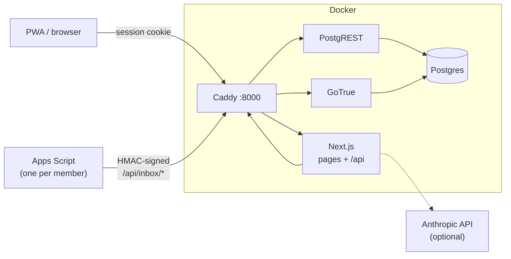

# Contributing

Thanks for helping. Illam is small and opinionated, so please open an issue before starting a
large change.

## Setup

You need Node.js 20+, pnpm 11 and Docker.

```bash
pnpm install
pnpm test:ci              # must pass: about 1,200 tests, no network, no AI calls
pnpm exec tsc --noEmit    # must be clean; next.config.js skips type errors in the build
```

Tests use the example household in `household.example.json` (Alice and Bob).

### Running the app

The quickest way is the full Docker stack from the [README](README.md#quick-start), plus
`node scripts/seed-demo.mjs` for sample data. For hot reload:

1. Start the backend without the app:
   `docker compose --profile bundled-db up -d db migrate rest auth`.
2. Run a gateway on port 8000 that sends `/rest/v1` and `/auth/v1` to those containers and
   everything else to `host.docker.internal:3000`: `docker/Caddyfile` with `app:3000` changed
   is enough.
3. Run `pnpm dev`. Next.js reads `.env`, so it uses the same keys as the stack.

## How the code is organised



- **Layers.** A page (`app/`) calls a hook (`lib/hooks`), which calls an API route (`app/api`).
  The route calls a service (`lib/services`), which calls a repository (`lib/repositories`),
  which queries PostgREST.
- **Inbox.** `InboxService` turns each message into facts with no AI involved
  (`lib/inbox/extractors`). `InboxAutomationService` then links, creates or settles records.
  Anything it cannot decide goes to the inbox's To do list. Internally the inbox is still called
  *Madal* in a few names (`MadalDecisionService`, `/api/madal`).
- **Statement PDFs** are unlocked and read in memory (`lib/statements`) and never stored.
- **Navigation** is defined once in `lib/navigation.ts`.
- **Styling.** Tailwind with the tokens in `tailwind.config.js`: `gray` is the neutral scale,
  `primary` the brand colour, `white` the card surface. Every colour is a CSS variable, so dark
  mode needs no `dark:` classes. Prefer the shared classes in `app/globals.css` (`.card`,
  `.btn`, `.input`, `.select`) and the components in `components/` (`PageHeader`,
  `PageContainer`, `SegmentedControl`, `MetricCard`) over one-off styles, and avoid hex colours.

## Ground rules

- **No real data.** No real names, account numbers, amounts from your own statements, merchant
  histories or email addresses in code, tests, comments or screenshots. Build fixtures from
  made-up values. CI runs gitleaks, but it cannot catch everything.
- **Schema changes** go in a new file in `db/migrations/` (dbmate format: `-- migrate:up`).
  Never edit a migration that has shipped.
- **Mail and PDFs are untrusted input.** Extractors must not execute or follow anything they read.
- **Keep it deployment-agnostic.** Nothing specific to one install: no domains, cloud accounts or
  project ids.

## Adding a bank or statement

1. **Sender.** Add an entry to `lib/inbox/sources.ts` with the sender addresses, and set
   `attachments: true` if its mails carry statement PDFs.
2. **Alerts.** Add or extend an extractor in `lib/inbox/extractors/`, and add tests in
   `lib/inbox/__tests__/extractors.test.ts` built from a *made-up* alert in the bank's exact wording.
3. **Statements.** Add a reader in `lib/statements/`. Build test PDFs with
   `lib/statements/__tests__/testPdf.ts`, using synthetic numbers in the real layout.
4. **Capturing a real layout without sharing it.** Set `INBOX_CAPTURE_STATEMENT_TEXT=1`, so the app
   stores the masked text of a few statements in `statement_samples`. Write the reader against
   that text, then rewrite every value before it goes into a test.

## Pull requests

- Keep each PR to one change. Add tests for behaviour changes.
- For UI changes, check a phone-width screen and dark mode.
- Describe what you checked by hand, such as a statement you parsed locally. Do not attach the
  statement.
