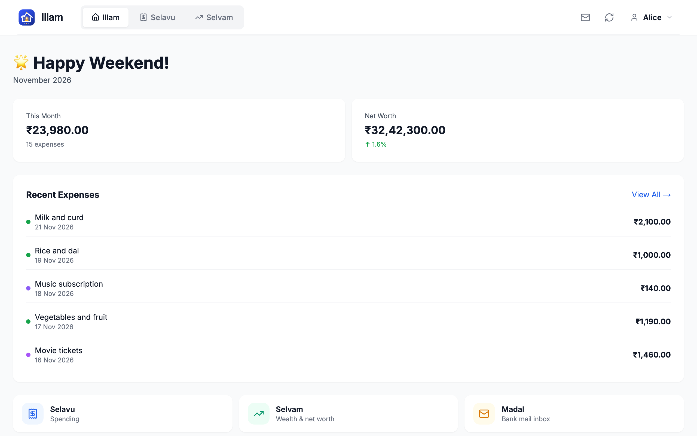
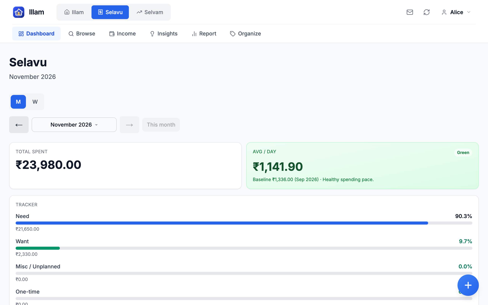
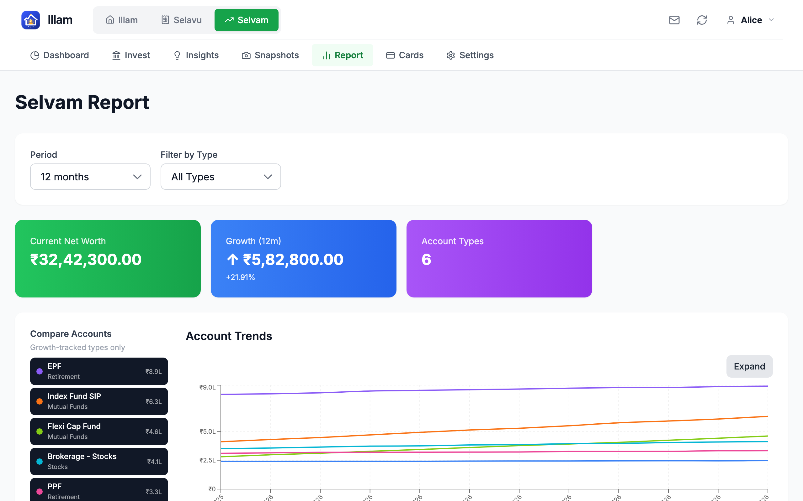
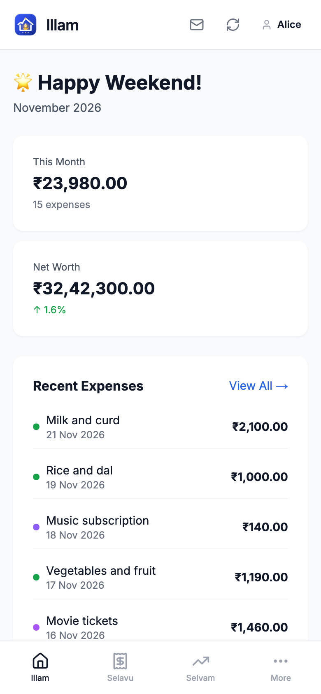
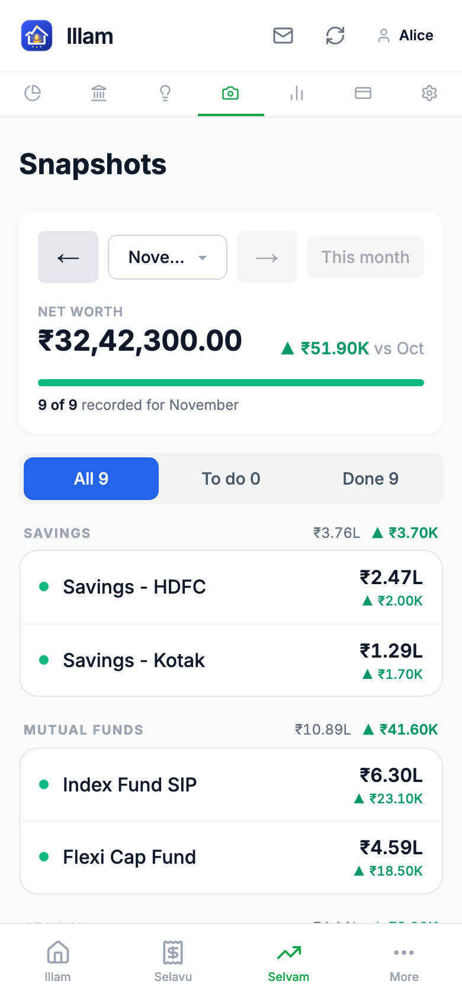
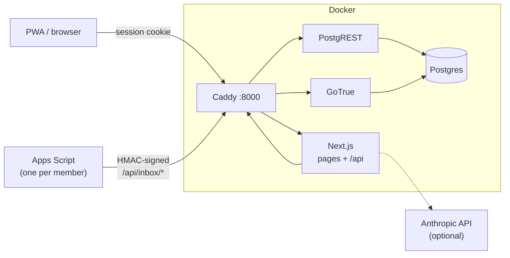

<p align="center"></p>

# Illam

**Self-hostable household finance for Indian families.** Illam tracks what a household spends,
earns, owns and owes. It reads the bank mail from each member's Gmail, so most of that tracking
happens on its own. *Illam* (இல்லம்) is Tamil for "home".

- **Your data stays on your server.** One `docker compose up` brings up Postgres, the API and the app.
- **It understands Indian bank mail.** UPI, card and NEFT alerts become expenses, transfers and
  income. Card statements, bank statements, CDSL/NSDL CAS and NPS statements become balances and
  holdings.
- **AI is optional.** With an Anthropic key it suggests categories, reads receipts and settles
  ambiguous transfers. Without one, every feature falls back to rules.
- **It is a PWA.** Install it on a phone: it is mobile-first and has an optional biometric lock.

> Status: early open-source release, extracted from a private app used daily by one household.
> Expect rough edges. Issues and PRs are welcome.

<p align="center">
  
  
</p>
<p align="center">
  
  
</p>
<p align="center">
  
  
</p>

<p align="center"><sub>Screenshots use the made-up household from <code>scripts/seed-demo.mjs</code>.</sub></p>

---

## Modules

| Module | Route | What it does |
|---|---|---|
| **Illam** (home) | `/home` | Month spend, net worth, cards due, what the inbox needs |
| **Selavu** (expenses) | `/expenses/*` | Expenses by month, bulk edit, categories, events and labels, reports, insights, income |
| **Selvam** (wealth) | `/portfolio/*` | Accounts, monthly snapshots, net worth, holdings, investments and SIPs, gold, credit cards, CAS import |
| **Madal** (inbox) | `/inbox` | Important bank mail reduced to facts. Alerts become expenses, transfers and income; statement PDFs become card statements and holdings |
| **Cash flow** | `/cash-flow` | Money in against money out, with commitments (premiums, EMIs, school fees) |
| **Activity tracker** | `/activity-tracker` | Milestones, habits with a log, and annual dates |
| **Kurippu** and **Seyal** | `/notes`, `/todos` | Shared notes and todos |
| Annual review | `/annual-review` | Twelve months of spending and wealth on one page |

### Supported mail and statements

| Source | Read today | Captured, reader not written yet |
|---|---|---|
| HDFC Bank | UPI, card and account alerts; credit card and savings account statements | |
| Axis Bank | Alerts; credit card statements | |
| ICICI Bank | Card alerts; credit card statements | |
| Kotak Mahindra Bank | Alerts; savings account statements | |
| CDSL and NSDL | Consolidated Account Statement (CAS) | |
| NPS (Protean) | Statements | |
| Groww | Mutual fund statements | |
| INDmoney | Trades, dividends, deposits | Weekly US-stocks statement |
| Zerodha | | Funds and holding statements |
| SBI | | Savings account statement |
| Bank of Baroda (BOBCARD) | Bill email | Card statement |

"Captured" means the PDF's masked text is sampled (`INBOX_CAPTURE_STATEMENT_TEXT`) so a reader
can be written against the real layout. Those make good first contributions.

Senders and parsers live in `lib/inbox/sources.ts`, `lib/inbox/extractors/` and `lib/statements/`.
To add a bank, see [CONTRIBUTING.md](CONTRIBUTING.md).

---

## Self-host it in five minutes

You need Docker (with Compose v2), Node.js 20+ and Git.

```bash
git clone https://github.com/kriznaraj/illam.git && cd illam
cp household.example.json household.json      # who is in your household (edit it)
node scripts/setup.mjs                        # writes .env: secrets, keys, household
docker compose --profile bundled-db up -d --build
node scripts/create-user.mjs --email you@example.com --member alice
```

Open <http://localhost:8000> and sign in with the password the last command printed. To look
around with sample data first, run `node scripts/seed-demo.mjs`.

**→ The full guide is [docs/self-hosting.md](docs/self-hosting.md).** It covers:
- HTTPS on your own domain or through a tunnel
- installing on phones
- connecting Gmail ([step-by-step guide](docs/gmail-sync.md))
- statement passwords
- AI features
- backups, upgrades and troubleshooting

### What runs

| Service | Image | Role |
|---|---|---|
| `db` | `postgres:17` | The database. Only with `--profile bundled-db`; or bring your own Postgres 15+ |
| `migrate` | `dbmate` | Applies `db/migrations/` on every start, then exits |
| `rest` | PostgREST | The data API the app's supabase-js client talks to |
| `auth` | GoTrue (`supabase/auth`) | Email and password sign-in. There is no sign-up page; accounts come from `create-user` |
| `app` | this repo's `Dockerfile` | The Next.js app |
| `gateway` | Caddy | One origin: `/rest/v1`, `/auth/v1`, and everything else to the app |

Already on Supabase? The app is supabase-js based. Apply `db/migrations/*.sql` to your
project, set `NEXT_PUBLIC_SUPABASE_URL`, `NEXT_PUBLIC_SUPABASE_ANON_KEY`,
`SUPABASE_SERVICE_ROLE_KEY` and `ILLAM_HOUSEHOLD`, and deploy the Next.js app anywhere Node runs.

---

## Configuration

`node scripts/setup.mjs` writes `.env`. Re-run it after editing `household.json`; existing
secrets are kept.

### The household (`household.json` → `ILLAM_HOUSEHOLD`)

One deployment serves one household. Each member is a person whose mail Illam reads:

```json
{
  "members": [
    {
      "slug": "alice",
      "name": "Alice",
      "payeeNames": ["ALICE"],
      "cas": { "demat": "<selvam account id>", "folios": "<selvam account id>" },
      "statementAccounts": { "hdfc_account_statement:1234": "<selvam account id>" },
      "contributionDestinations": { "5678": { "accountId": "<selvam account id>", "alsoCheck": [] } }
    }
  ]
}
```

| Field | Meaning |
|---|---|
| `slug` | Lower-case id. Used in the Gmail script (`ILLAM_OWNER`) and in env var names |
| `payeeNames` | How banks print this person as a payee. A debit to yourself is an own-account move; a debit to another member is a household transfer |
| `cas` | Which Selvam accounts this member's CDSL CAS updates: a demat account, plus one folio account or a fund-name split (`folioAccounts`) |
| `statementAccounts` | Which Selvam account each emailed balance statement sets, keyed `<source id>:<last 4 digits>` |
| `contributionDestinations` | Accounts outside the household (a broker wallet, a savings scheme) that statements show money going into, keyed by last 4 digits |

Everything except `slug` and `name` is optional. Start with names only and add the account
mappings once the accounts exist in Selvam. An account's id is in its page URL.

### Environment

| Variable | Required | Purpose |
|---|---|---|
| `PUBLIC_URL` | yes | Where people open Illam. It is also the API origin |
| `DATABASE_URL` | yes | Postgres connection used by migrations, PostgREST and GoTrue |
| `JWT_SECRET`, `ANON_KEY`, `SERVICE_ROLE_KEY` | yes | Generated. The service key is server-only |
| `ILLAM_HOUSEHOLD` | yes | Generated from `household.json` |
| `INBOX_SECRET_<SLUG>` | for Gmail sync | One per member. Signs the Apps Script's requests |
| `STATEMENT_PASSWORDS_<SLUG>` | for statement PDFs | JSON map of source id to passwords. Stays in the environment, never in the database |
| `ANTHROPIC_API_KEY` | no | Turns on the AI features |

### Gmail sync

Each member installs a small Google Apps Script in their own Gmail. Every 15 minutes it pushes
matching bank mail to the server, signed with that member's secret. It is read-only on the
mailbox, and the server keeps the extracted facts, never the email or PDF. Setup takes about
10 minutes per member: **[docs/gmail-sync.md](docs/gmail-sync.md)**.

---

## Architecture



- **Layers:** a page calls a hook in `lib/hooks`, which calls an API route in `app/api`. The
  route calls a service in `lib/services`, which calls a repository in `lib/repositories`, which
  queries PostgREST.
- **Inbox:** `InboxService` turns each message into facts with no AI involved (`lib/inbox/extractors`).
  `InboxAutomationService` then links, creates or settles records. Anything it cannot decide
  goes to the Madal To-do.
- **Statement PDFs** are unlocked and read in memory (`lib/statements`) and never stored.

## Security model

- **One household per deployment.** Every signed-in member can see all of the household's data.
- **Row level security is on for every table.** Only the `authenticated` and `service_role`
  roles have grants. The anon key that ships to the browser reads and writes nothing
  (`db/migrations/*_security.sql`).
- **Middleware requires a session for every route except two.** `/api/inbox/ingest` and
  `/api/inbox/process` instead verify a per-member HMAC signature with a timestamp, and use the
  service role.
- **Never stored:** email bodies, OTP mail, full card or account numbers, statement passwords,
  statement PDFs.
- **Sign-up is disabled.** Create accounts with `scripts/create-user.mjs` and reset passwords with
  `scripts/reset-password.mjs`. Both need the service key, so they only run on the server.

Found a vulnerability? See [SECURITY.md](SECURITY.md).

## Development

```bash
pnpm install
pnpm test:ci          # Vitest: about 1,200 tests, no network, no AI calls
npx tsc --noEmit      # next.config.js skips type errors during the build, so check here
```

To run the app with hot reload against the Docker backend:

1. Start everything except the app: `docker compose --profile bundled-db up -d db migrate rest auth`.
2. Run `pnpm dev`, with `NEXT_PUBLIC_SUPABASE_URL` pointing at a gateway that routes to it.
   The simplest gateway is to run Caddy locally with `docker/Caddyfile` and `app:3000` changed to
   `host.docker.internal:3000`.

Schema changes go in a new file in `db/migrations/` (dbmate format), applied on the next
`docker compose up`.

## Contributing

Bank parsers are the most useful contribution. See [CONTRIBUTING.md](CONTRIBUTING.md), and please
follow the [Code of Conduct](CODE_OF_CONDUCT.md).

## License

[AGPL-3.0](LICENSE). You can run, modify and self-host it freely. If you offer a modified version
to others over a network, you must publish your changes under the same licence.
