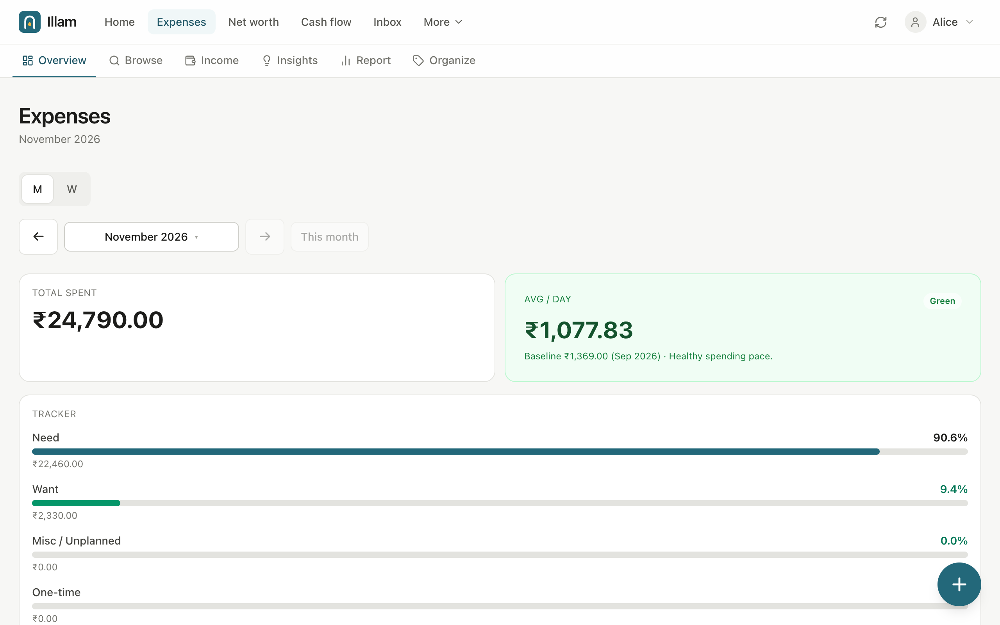
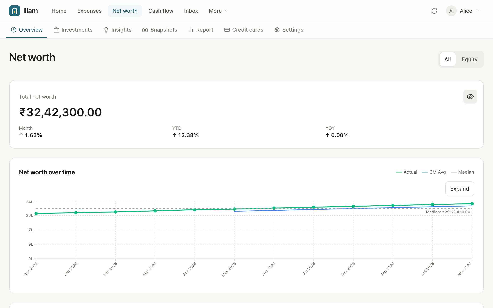
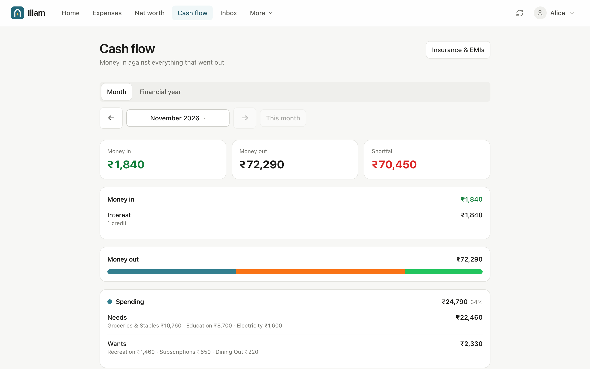

<p align="center"></p>

<h1 align="center">Illam</h1>

<p align="center"><b>Self-hosted household finance for Indian families.</b><br>
Expenses, income, net worth and bank mail, for the whole family, on your own server.</p>

<p align="center">
  
  
</p>
<details>
<summary>More screenshots</summary>
<p align="center">
  
  
</p>
<p align="center">
  
  
</p>
</details>

*Illam* (இல்லம்) is Tamil for "home". Screenshots use the made-up household from
`scripts/seed-demo.mjs`.

## Why Illam

- **Your data stays on your server.** One `docker compose up` runs the database, API and app.
- **It reads Indian bank mail.** UPI, card and NEFT alerts become expenses, transfers and income.
  Card and bank statements, CDSL/NSDL CAS and NPS statements become balances and holdings.
- **Built for a household.** Each member signs in and connects their own Gmail; everyone sees
  the same books.
- **AI is optional.** With an Anthropic API key it suggests categories, reads receipts and
  settles ambiguous transfers. Without one, everything runs on rules.
- **Works on your phone.** Install it as an app (PWA), with an optional biometric lock.

> **Status:** early release. Expect rough edges; issues and pull requests are welcome.

## Quick start

You need Docker with Compose v2, Node.js 20+ and Git.

```bash
git clone https://github.com/kriznaraj/illam.git && cd illam
cp household.example.json household.json        # list your household members
node scripts/setup.mjs                          # writes .env with fresh secrets
docker compose --profile bundled-db up -d     # pulls the published image
node scripts/create-user.mjs --email you@example.com --member alice
```

Open <http://localhost:8000> and sign in with the password the last command printed.
Want sample data first? Run `node scripts/seed-demo.mjs` on a fresh install.

**Next:** [the self-hosting guide](docs/self-hosting.md) covers HTTPS, phones, your own
Postgres, backups and upgrades. [Gmail sync](docs/gmail-sync.md) connects each member's bank
mail (about 10 minutes per person).

## What's inside

| Section | What it does |
|---|---|
| **Home** | This month's spending, net worth, cards due and anything waiting on you |
| **Expenses** | Expenses by month, bulk edit, categories, events, tags, reports and insights |
| **Net worth** | Accounts, monthly snapshots, holdings, investments and SIPs, gold, credit cards, CAS import |
| **Inbox** | Bank mail reduced to facts: alerts become expenses, transfers and income; statements update balances |
| **Cash flow** | Income, and money in against money out, including insurance premiums, EMIs and school fees |
| **More** | Shared notes and to-dos, an activity tracker and an annual review |

### Supported banks and statements

| Source | Read today | Captured, reader still to be written |
|---|---|---|
| HDFC Bank | UPI, card and account alerts; credit card and savings statements | |
| Axis Bank | Alerts; credit card statements | |
| ICICI Bank | Card alerts; credit card statements | |
| Kotak Mahindra Bank | Alerts; savings statements | |
| CDSL and NSDL | Consolidated Account Statement (CAS) | |
| NPS (Protean) | Statements | |
| Groww | Mutual fund statements | |
| INDmoney | Trades, dividends, deposits | Weekly US-stocks statement |
| Zerodha | | Funds and holding statements |
| SBI | | Savings statement |
| Bank of Baroda (BOBCARD) | Bill email | Card statement |

Adding a bank is the most useful contribution: see [CONTRIBUTING.md](CONTRIBUTING.md).

## Security and privacy

- One household per installation. Every member can see the household's data.
- Row level security on every table; the browser's anon key can read nothing.
- No public sign-up. Accounts are created on the server with `scripts/create-user.mjs`.
- The Gmail sync is read-only, and each request is signed with that member's secret.
- Never stored: email bodies, OTP mail, full card or account numbers, statement passwords or PDFs.

Found a vulnerability? Please report it privately: see [SECURITY.md](SECURITY.md).

## Contributing

See [CONTRIBUTING.md](CONTRIBUTING.md) for the development setup, the architecture and how to add
a bank. Please follow the [Code of Conduct](CODE_OF_CONDUCT.md).

## License

[AGPL-3.0](LICENSE). You can run, modify and self-host Illam freely. If you offer a modified
version to others over a network, you must publish your changes under the same licence.
